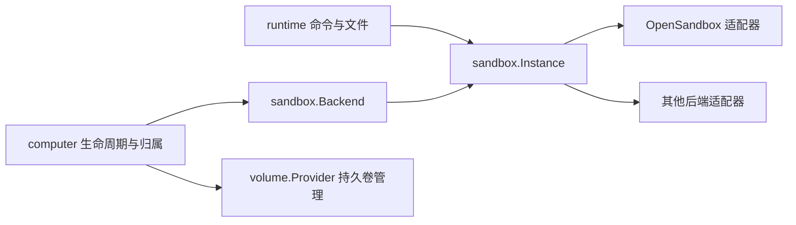

# 沙箱后端接口预览

状态：设计草案，供评审；本轮仅落地 `FileReader` 原生读取接口，不进行全系统后端迁移。

## 边界

一个云电脑实例属于一个用户。workspace、storage、agent scope 是导航起点，不是同一实例内部的安全隔离域；跨用户、跨电脑、generation 和平台维护权限仍须隔离。工作负载使用非 root 身份，业务调用方不能任意选择 UID 0。

目前已有 `computer.Backend`，但其 `Ensure` 返回具体的 `*sandbox.Handle`；文件元数据仍有 SDK 类型别名，挂载计划直接映射 PVC。这些依赖使替换后端仍需改业务代码。可将稳定契约放在 `internal/sandbox`，把 OpenSandbox SDK、认证、端点和类型转换移入 `internal/sandbox/opensandbox`。



## 核心契约示意

以下是接口形状预览，所引用的 DTO 应由本项目定义，不能使用供应商 SDK 类型。最终命名在实现阶段统一。

```go
type Backend interface {
    Capabilities() Capabilities
    Ensure(context.Context, InstanceSpec, EnsurePolicy) (Instance, error)
    Inspect(context.Context, InstanceRef) (InstanceInfo, error)
    Delete(context.Context, InstanceRef) error
}

type Instance interface {
    Ref() InstanceRef
    Commands() Commands
    Files() FileSystem // 固定工作负载身份，不暴露 root 或任意 UID 参数
}

type Commands interface {
    Start(context.Context, CommandSpec) (Execution, error)
}

type Execution interface {
    ID() string
    Wait(context.Context, func(OutputEvent)) (CommandResult, error)
    Stop(context.Context) (StopResult, error)
}

type FileReader interface { // 本轮已落地的最小切片
    List(context.Context, string) ([]FileEntry, error)
    Stat(context.Context, string) (FileEntry, error)
    Open(context.Context, string, int64) (io.ReadCloser, error)
}

type FileSystem interface {
    FileReader
    Put(context.Context, string, io.Reader, PutOptions) error
    Mkdir(context.Context, string, MkdirOptions) error
    Remove(context.Context, string, RemoveOptions) error
}

// 可选能力：不强迫所有后端假装支持暂停或租约。
type Pausable interface {
    Pause(context.Context, InstanceRef) error
    Resume(context.Context, InstanceRef) error
}
type Renewable interface {
    Renew(context.Context, InstanceRef, time.Duration) error
}
```

`InstanceRef` 包含 BackendID、供应商实例 ID、ComputerID、Generation；`InstanceSpec` 另包含 installation/org/user 身份、镜像、资源、网络规则及中立挂载描述。规格不包含凭据，认证由适配器配置。`EnsurePolicy` 显式区分仅连接和允许创建，未知创建结果必须先按身份发现，避免重复创建。

`FileEntry` 由项目定义 path/kind/size/modifiedAt；流的关闭由调用者负责，取消请求必须关闭 HTTP 传输。`Open` 的大小限制是传输上限，调用方仍需有界读取；超过业务限额应报错或显式标注截断。scope 不承诺 race-safe 目录 confinement。符号链接和特殊文件支持以能力和适配器实际行为为准，不声称所有后端完全一致。

`CommandSpec` 需要 cwd/env/timeout 与 shell 或 argv 的明确选择；`OutputEvent` 带 stdout/stderr 和原始字节，不补换行。`StopResult` 区分已确认停止与状态未知，网络取消不能等同于远端进程终止。当前受监督执行协议应保留在命令实现中，确认停止前不得释放维护占用。

`PutOptions` 必须明确是否允许覆盖、是否要求原子提交；不支持的后端返回 Unsupported，不能悄悄降级为覆盖写。长时间下载快照、目录打包属于上层作业，复用文件流或后端专用能力，不塞入基础接口。

统一错误至少区分 NotFound、PermissionDenied、Conflict、Unsupported、Unavailable、CompletionUnknown，使用 `errors.Is/As`；适配器保留内部原因供日志诊断，业务响应不泄露供应商凭据。

## 持久卷与维护能力

保留独立 `volume.Provider`。挂载描述表达 claim、目标路径和只读属性，后端检查存储域与挂载能力。换后端不等于可以自动挂载原 Docker volume；跨存储域迁移需要显式导出/导入流程。

技能安装、目录初始化和只读导出快照目前依赖受信维护能力。另设仅注入 computer/skill 管理服务的 `Maintainer`，任务工具仅获得 `Instance`。不将维护命令或 root 文件接口挂在公开的 `Instance` 上，也不把 Wispjar 技能修订协议变成所有沙箱后端的硬编码方法。

## 迁移顺序

1. 本轮：SDK v1.1.1 + 官方 execd release-1.1.1；文件列表、读取、预览走 `FileReader`，UID/GID 固定为 65532。上传、保存和下载打包保留现有明确的冲突及快照语义。
2. 评审后：定义中立 DTO/error，移除 SDK 类型别名，把现有适配器迁移到子包；`computer.Backend` 返回 `Instance`，运行时不再依赖具体 Handle 字段。
3. 收敛命令及受信维护契约，按能力注册后端工厂；持久记录继续用 BackendID + 实例 ID + generation，不另建重复的生命周期状态机。
4. 接第二种真实后端，跑同一组契约测试：归属与重建隔离、创建结果未知恢复、输出字节、取消停止确认、文件限制和并发、暂停能力、持久卷保留。由真实差异验证抽象，而不是先写空实现。

## 版本与升级

官方 Go SDK：`github.com/alibaba/OpenSandbox/sdks/sandbox/go v1.1.1`；execd 镜像标签为 `release-1.1.1`。身份文件路由是 `/v1/filesystem/{uid}/{gid}`，不支持时明确报错，不回退到默认 root 文件 API。现有实例中 execd 位于各自 runtime 卷，仅修改 server 默认镜像不会更新已有实例；升级须在空闲时执行，并验证实例、用户三卷及命令协议，保留回滚入口。

参考：[官方 release-1.1.1](https://github.com/opensandbox-group/OpenSandbox/releases/tag/release-1.1.1)、[Go 身份文件接口](https://github.com/opensandbox-group/OpenSandbox/blob/release-1.1.1/sdks/sandbox/go/filesystem_identity.go)。
