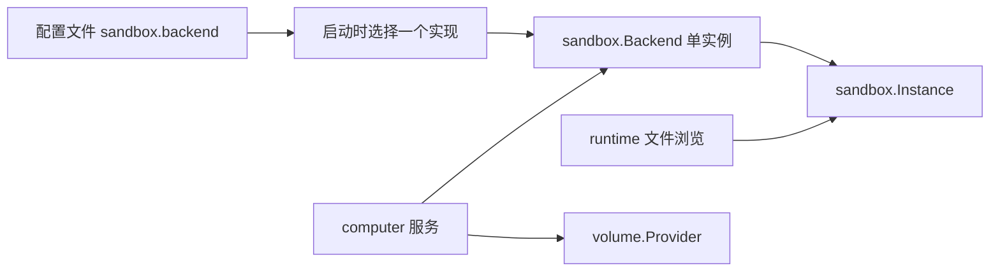

# 沙箱后端接口设计与实施

状态：后端中立接口、OpenSandbox 适配器拆包、Instance 接线和维护权限分离已实施。本次只提供 OpenSandbox 一个实际后端。

## 单后端配置与组装

一个 Wispjar 进程在启动时选择一个沙箱实现，所有云电脑使用同一个后端对象。选择来自配置文件，修改后重启生效；不做按用户/电脑路由、热切换、后端注册表或多后端管理界面。

```yaml
sandbox:
  backend: opensandbox

opensandbox:
  lifecycle_url: http://localhost:8081
  api_key: ""
  use_server_proxy: false
```

省略 `sandbox.backend` 时默认 `opensandbox`，保留原来的顶层 `opensandbox` 配置以及 `WISPJAR_SANDBOX_KEY` 覆盖行为。当前只接受 `opensandbox`，其他值和显式空值启动时报错；不能将未知实现静默回退到 OpenSandbox。未配置 lifecycle URL 时沿用原行为，沙箱服务不启用。

`cmd/wispjar/sandbox.go` 使用一个简单的 switch 构造实现，主程序只构造一次并注入 computer 服务。将来真正接入另一实现时，再添加适配器、配置校验和构造分支，无需提前建设注册机制。



## 单后端与资源身份

`sandbox.backend` 在启动时选择唯一实现，当前仅支持 `opensandbox`；`storage.volumes.backend` 选择存储驱动，当前为 `docker`。不设置额外的后端实例 ID，也不在电脑、用户卷、挂载或沙箱引用中持久化它。

数据库属于当前部署环境。实例使用安装标识、ComputerID、用户、机构和 Generation 验证身份；卷使用安装标识、卷 ID、用户、机构和种类标签验证归属，卷名在数据库内全局唯一。更换端点或后端实现不等于迁移资源，已有实例及卷需要显式迁移。

迁移 12 删除电脑和用户卷的旧后端标识列，卷名唯一约束改为全库唯一，不提供旧字段读写兼容层或自动降级。

## 核心接口

契约位于 `internal/sandbox`；SDK、认证、端点、PVC 和元数据转换位于 `internal/sandbox/opensandbox`。computer/runtime 不导入适配器或 SDK。

```go
type Backend interface {
    Ensure(context.Context, ComputerSpec, EnsurePolicy) (Instance, error)
    Inspect(context.Context, ComputerSpec) (string, error)
    Delete(context.Context, ComputerSpec) error
}

type EnsurePolicy struct { AllowCreate, AllowResume bool }

type Instance interface {
    Ref() InstanceRef
    Files() (FileReader, error)
}

type FileReader interface {
    List(context.Context, string) ([]FileEntry, error)
    Stat(context.Context, string) (FileEntry, error)
    Open(context.Context, string, int64) (io.ReadCloser, error)
}
```

`Ensure` 区分连接、允许创建和允许恢复。普通连接使用零值策略；已知实例 ID 消失时不自动补建。创建结果未知时按身份发现，避免重复创建。computer 服务核对返回的 ComputerID、Generation 和实例 ID。

`ComputerSpec` 携带资源归属、代次、实例引用、运行配置和已解析的挂载计划。业务归属、重建、运行占用及技能修订由业务层管理，适配器只负责供应商操作，不再建立另一套持久生命周期状态机。

一个云电脑整体属于一个用户。workspace、storage、agent scope 是导航起点，不作为实例内部隔离域；跨用户和代次检查仍保留。普通文件操作使用工作负载身份，OpenSandbox 实现当前采用 UID/GID 65532。

FileEntry/FileInfo/CommandResult 是项目自己的类型。文件通过流传输，调用方关闭流并有界读取；预览限额属于业务规则。没有后端原生文件 API 时明确失败，不回退到 root 文件接口。

## 可选能力与维护

暂停和续期的差异与是否同时启用多个后端无关，保留两个可选接口即可。不再另外维护 `Capabilities` 布尔声明，避免两套能力信息不一致。

```go
type Pausable interface {
    Pause(context.Context, ComputerSpec) error
}

type Renewable interface {
    Renew(context.Context, ComputerSpec) error
}

type MaintenanceProvider interface {
    Maintainer(Instance) (Maintainer, error)
}
```

实现 Pausable 即可暂停，恢复通过 EnsurePolicy 显式授权。没有暂停接口时拒绝显式暂停并跳过后台空闲暂停；没有 Renewable 时跳过续期。OpenSandbox 实现这两种能力。

Maintainer 保留现有同步 Operations 和平台导出流接口，供受信服务初始化目录、安装技能和生成下载快照。普通 Instance 使用独立包装对象，不能通过类型断言取得维护句柄。MaintenanceProvider 校验连接属于自身；这个检查也防止旧配置或错误连接混用，不要求运行多个后端。

普通文件浏览不获取维护句柄；初始化、写入或导出时才获取。运行时仍通过 ExecutionHandle 降权、监督命令，并在确认远端停止后释放占用；取消本地请求不等于命令停止。

SDK 错误在适配器边界转换成项目错误类别，并保留内部 cause。文件不存在和权限错误使用 io/fs 类别；业务层不依赖 SDK 错误类型。

## 本次范围与验证

已实现：单后端配置选择、中立类型、适配器拆包、Instance 接线、维护权限分离、可选暂停/续期、后端标识字段删除和数据库迁移。验证覆盖身份、创建/恢复、无维护文件读取、迁移数据保留和全局卷名唯一约束。测试内存桩不注册为产品后端。

本次不增加其他实际沙箱、后端路由、多后端界面、跨后端迁移、异步命令对象或完整文件写入新协议。已有同步命令和上传/保存语义继续使用；以后出现具体需求时再扩展，避免提前扩大接口。

## OpenSandbox 版本

Go SDK 为 `github.com/alibaba/OpenSandbox/sdks/sandbox/go v1.1.1`，官方 execd 镜像标签为 `release-1.1.1`。身份文件路由是 `/v1/filesystem/{uid}/{gid}`。已有实例的 execd 位于各自 runtime 卷，修改 server 默认镜像不会升级已有实例；升级应在空闲时执行并保留回滚入口。

参考：[官方 release-1.1.1](https://github.com/opensandbox-group/OpenSandbox/releases/tag/release-1.1.1)、[Go 身份文件接口](https://github.com/opensandbox-group/OpenSandbox/blob/release-1.1.1/sdks/sandbox/go/filesystem_identity.go)。
